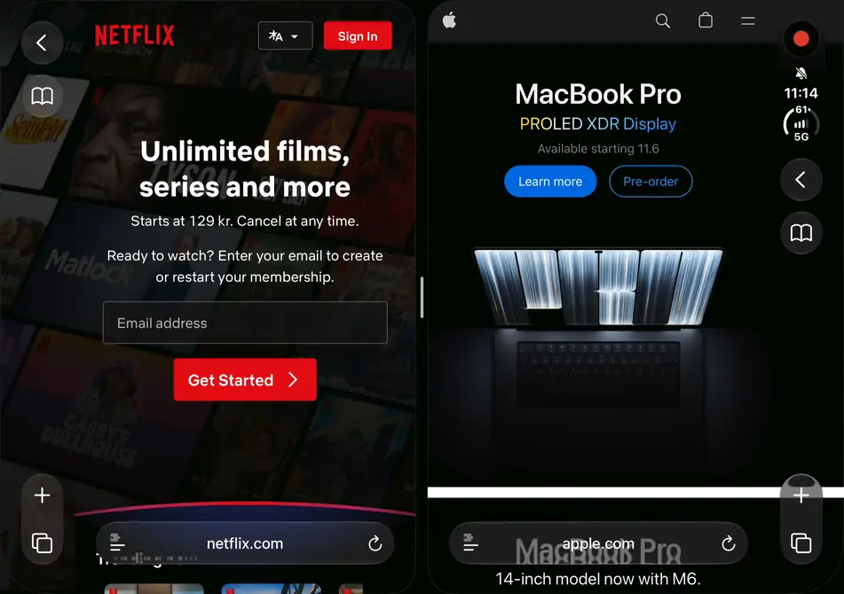

# DuoWide

**Webseiten, die in Safari das ganze Außendisplay des iPhone Duo nutzen.**

⭐ Wenn dir DuoWide gefällt, gib ihm bitte oben auf dieser Seite einen **Star**. Das hilft anderen mit einem iPhone Duo, es zu finden.

[English](README.md) · [한국어](README.ko.md) · [日本語](README.ja.md) · [简体中文](README.zh-CN.md) · [繁體中文](README.zh-TW.md) · [Español](README.es.md) · [Português](README.pt-BR.md) · [Français](README.fr.md) · **Deutsch**

[Herunterladen](https://github.com/hyungchulc/duowide/releases/latest/download/DuoWide.zip) · [Website melden](https://github.com/hyungchulc/duowide/issues/new/choose)

  

Vollständiges Video (19 s, 60 fps)

https://github.com/user-attachments/assets/64fab1b0-b13f-4736-ae52-480a993d2d6b

Auf dem Außendisplay des iPhone Duo sitzen die Buttons von Safari in einem Glasstreifen am rechten Rand, und Safari
stellt Seiten nur bis zu diesem Streifen dar. Die 84 pt darunter bleiben deshalb leer. DuoWide ist ein Userscript für
die kostenlose Safari-Erweiterung [Userscripts](https://apps.apple.com/us/app/userscripts/id1463298887). Es stellt
Seiten auf dem ganzen Display dar, bis unter den Streifen, und sorgt dafür, dass er nichts verdeckt, was du antippen
möchtest.

> **Beta.** DuoWide ist noch in der Betaphase, und das Querformat wird noch nicht unterstützt. Noch kommt es nicht mit
> jeder Website zurecht: Wenn eine Website falsch aussieht,
> [erstelle ein Issue](https://github.com/hyungchulc/duowide/issues/new/choose) oder schreib eine E-Mail an
> [hyungchulc@gmail.com](mailto:hyungchulc@gmail.com), und ich behebe das so schnell wie möglich.

## Was DuoWide macht

- Seiten nutzen die volle Breite des Displays (466 pt statt 382 pt). Fotos, Hintergründe und die Farben von Leisten
  laufen unter dem Streifen weiter, der dabei durchsichtiges Glas bleibt.
- Links, Buttons und Textfelder, die der Streifen verdecken würde, rücken nach innen, damit du sie weiterhin antippen
  kannst.
- Absätze, Kommentare und anderer Fließtext brechen vor dem Streifen um, damit keine Zeile unter seinen Buttons endet.
  Wenn du stattdessen mehr Wörter in eine Zeile bekommen möchtest, füge den optionalen Schalter
  [Breiter Text](#breiter-text-optional) hinzu.
- Menüs, Tableisten und andere fixierte Leisten enden vor dem Streifen, und ihre Farbe läuft unter ihm weiter.
- Karussells bekommen am Ende zusätzlichen Platz, damit du auch das letzte Element unter dem Streifen hervorwischen
  kannst.
- Videoplayer, deren Buttons sich nicht verschieben lassen (von anderen Websites eingebettete Player, Videos mit den
  eigenen Steuerelementen von Safari), laufen wie Bilder unter dem Streifen weiter, bis du sie antippst oder abspielst.
  Dann enden sie vor dem Streifen, damit sich Vollbild und Lautstärke weiterhin antippen lassen.
- Die Seite verrutscht nicht seitlich. Zoomen mit zwei Fingern und die Wischgesten vom Rand für Zurück und Vorwärts
  funktionieren weiterhin. DuoWide zeichnet den Scrollbalken der Seite selbst, damit unten nicht der horizontale
  Scrollbalken von iOS erscheint.
- In Split View auf dem aufgeklappten Display (Safari neben einer anderen App) laufen die Farben und Hintergründe der
  Seite auch unter dem Streifen von Safari am Fensterrand weiter, während Text, Bilder und Buttons außerhalb des
  Streifens bleiben. Soll Split View so bleiben, wie Safari es darstellt, setze `split` auf `false`.
   
- Auf anderen iPhone-Modellen, auf iPad und Mac sowie auf dem aufgeklappten Display des iPhone Duo, wenn Safari es
  allein nutzt, ändert DuoWide nichts.

## Installation

1. Installiere [Userscripts](https://apps.apple.com/us/app/userscripts/id1463298887) aus dem App Store.
2. Lade in Safari auf dem iPhone
   [DuoWide.zip](https://github.com/hyungchulc/duowide/releases/latest/download/DuoWide.zip) herunter und tippe die
   Datei dann in der App „Dateien“ (Ordner „Downloads“) an, um sie zu entpacken. Der Ordner `DuoWide` enthält zwei
   Skripte. Behalte beide:
   - `DuoWide.user.js` erledigt die eigentliche Arbeit.
   - `DuoWide-Frames.user.js` verhindert, dass die Seite verrutscht, wenn eine Wischbewegung in einem Frame innerhalb
     der Seite beginnt, etwa in einer Anzeige oder einem eingebetteten Video, und meldet der Seite, wenn du ein
     eingebettetes Video antippst.

   Verschiebe den Ordner an einen Ort, an dem er bleiben kann, etwa in iCloud Drive oder unter „Auf meinem iPhone“.
3. Öffne die Userscripts-App, tippe auf **Change Userscripts Directory** und wähle den Ordner `DuoWide`.
   - Wenn du Userscripts schon nutzt, behalte deinen Ordner und kopiere stattdessen die beiden Skripte hinein.
4. Aktiviere unter **Einstellungen → Apps → Safari → Erweiterungen → Userscripts** die Erweiterung und stelle
   **Allen Websites** auf **Erlauben**.
5. Empfohlen: Deaktiviere unter **Einstellungen → Apps → Safari** die Option **Toptreffer vorab laden**. Während du eine
   Adresse eingibst, lädt Safari den Toptreffer schon im Voraus. Auf einer so geladenen Seite können Erweiterungen nicht
   laufen, deshalb öffnet sie sich ohne DuoWide, bis du sie neu lädst.
6. Öffne in Safari auf dem Außendisplay eine Seite oder lade sie neu.

**Oder installiere direkt in Safari.** Öffne bei aktivierter Erweiterung
[DuoWide.user.js](https://raw.githubusercontent.com/hyungchulc/duowide/main/DuoWide.user.js), öffne Userscripts über
das Erweiterungsmenü von Safari und tippe auf den Installationshinweis. Mach dasselbe für
[DuoWide-Frames.user.js](https://raw.githubusercontent.com/hyungchulc/duowide/main/DuoWide-Frames.user.js).

## Breiter Text (optional)

Standardmäßig bricht DuoWide Absätze, Kommentare und anderen Fließtext vor dem Streifen um, damit keine Zeile unter den
Buttons von Safari endet. Wenn du lieber mehr Wörter in eine Zeile bekommen möchtest, etwa bei vergrößerter Seite, füge
das optionale Skript `DuoWide-WideText.user.js` hinzu:

- Textzeilen laufen unter dem Streifen weiter, bis zum Rand des Displays. Sie scheinen durch das Glas hindurch. Verdeckt
  sind nur die Buchstaben, die gerade direkt unter einem Button liegen, und beim Scrollen ziehen sie an ihm vorbei.
- Ein Absatz, dessen Link unter dem Streifen landen würde, bricht weiterhin vor dem Streifen um, damit sich der Link
  antippen lässt. Links, Buttons, Menüs, Tabellen und Videos werden wie bisher behandelt.
- Es ist ein Schalter für `DuoWide.user.js` ab Version 1.6.5 und bewirkt allein nichts. Wenn dein DuoWide älter ist,
  aktualisiere es also zuerst. Jedes Skript im Ordner ist aktiv. Deshalb liegt dieses nicht in `DuoWide.zip`: Es ist
  nur da, wenn du es selbst hinzufügst.

**Hinzufügen**

1. Öffne bei aktivierter Userscripts-Erweiterung
   [DuoWide-WideText.user.js](https://raw.githubusercontent.com/hyungchulc/duowide/main/DuoWide-WideText.user.js) in
   Safari auf dem iPhone.
2. Öffne Userscripts über das Erweiterungsmenü von Safari und tippe auf den Installationshinweis. Das Skript wird in
   deinem Userscripts-Ordner gespeichert, neben den anderen beiden.
3. Lade die Seite, die du gerade liest, neu.

Oder lade `DuoWide-WideText.user.js` aus dem [neuesten Release](https://github.com/hyungchulc/duowide/releases/latest)
(unter **Assets**) herunter und verschiebe es in den Ordner mit den anderen beiden Skripten. Öffne danach einmal das
Userscripts-Menü in Safari, damit Userscripts die neue Datei erkennt.

**Aus- oder wieder einschalten**

Öffne Userscripts über das Erweiterungsmenü von Safari, tippe in der Liste auf **DuoWide-WideText**, um es auszuschalten
(oder wieder einzuschalten), und lade die Seite neu. Es bleibt auch bei Updates ausgeschaltet, bis du es wieder
einschaltest. Um es zu entfernen, lösche die Datei aus dem Ordner.

## Updates

Die Skripte prüfen in diesem Repository, ob es neue Versionen gibt. Sobald eine erschienen ist, wird sie im
Userscripts-Menü in Safari angezeigt: Tippe auf **Update All**. Du kannst auch die neue ZIP-Datei herunterladen und die
beiden Dateien ersetzen (und `DuoWide-WideText.user.js` aus dem Release, falls du es nutzt).

## Einstellungen

`CONFIG` ganz oben in `DuoWide.user.js`:

| Einstellung | Standardwert | Was sie bewirkt |
| --- | --- | --- |
| `skip` | `[]` | Websites, die so bleiben sollen, wie sie sind, etwa `["example.com"]` (auch Subdomains). |
| `landscape` | `false` | Seiten auch im Querformat verbreitern. Noch nicht unterstützt. |
| `left` | `false` | Bei aktiviertem `landscape` Seiten auch dann verbreitern, wenn der Streifen links ist. |
| `bar` | `true` | Den horizontalen Scrollbalken von iOS ausblenden und stattdessen den vertikalen selbst zeichnen. `false` behält die Scrollbalken von iOS. |
| `split` | `true` | In Split View auf dem aufgeklappten Display die Farben der Seite auch unter dem Streifen von Safari weiterlaufen lassen. `false` lässt Split View so, wie Safari es darstellt. |

Bearbeite die Datei mit einer Editor-App, die Dateien direkt an ihrem Speicherort bearbeiten kann. Ein Update ersetzt
die Datei, also trage diese Werte nach dem Aktualisieren erneut ein.

## Bekannte Probleme

- Das Querformat wird noch nicht unterstützt. Im Querformat bleiben Seiten so, wie Safari sie darstellt.
- Eine Seite, die ein Menü neben dem Inhalt hat und beim Öffnen schon daran vorbeigescrollt ist, etwa chatgpt.com,
  bleibt bei der Standardbreite von Safari. Verbreitert würden die Leisten von Safari jedes Mal zurückbleiben, wenn das
  Menü herein- oder herausgleitet.
- Auf verbreiterten Seiten zoomt Doppeltippen hinein. Safari erlaubt das, wenn die Breite einer Seite als Zahl
  festgelegt ist, und die Einstellung, die es abschaltet, lässt sich nicht mit der kombinieren, die das seitliche
  Verrutschen der Seite verhindert.
- Manche Websites funktionieren noch nicht gut. Bitte melde sie.

## Website-Wunsch oder Problem melden

[Erstelle ein Issue](https://github.com/hyungchulc/duowide/issues/new/choose) mit der Adresse der Seite, einer
Beschreibung, was falsch aussieht, und wenn möglich einem Screenshot, oder schreib eine E-Mail an
[hyungchulc@gmail.com](mailto:hyungchulc@gmail.com). Ich sorge so schnell wie möglich dafür, dass sie funktioniert.

## Lizenz

[MIT](LICENSE)
