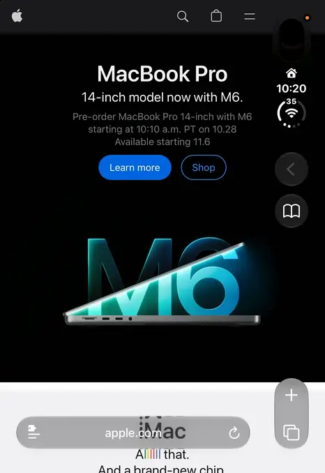

# DuoWide

**Web pages that use the whole iPhone Duo outer screen in Safari.**

⭐ If you like DuoWide, please give it a **Star** at the top of this page. It helps other iPhone Duo users find it.

[한국어](README.ko.md) · [Download](https://github.com/hyungchulc/duowide/releases/latest/download/DuoWide.zip) · [Request a site](https://github.com/hyungchulc/duowide/issues/new/choose)

  

Full video (19 s, 60 fps)

https://github.com/user-attachments/assets/64fab1b0-b13f-4736-ae52-480a993d2d6b

On the iPhone Duo outer screen, Safari keeps its buttons in a glass strip along the right side and lays pages out
only up to that strip, so the 84 pt under it stays empty. DuoWide is a userscript for the free
[Userscripts](https://apps.apple.com/us/app/userscripts/id1463298887) Safari extension. It lays pages out across the
whole screen, under the strip, and keeps everything you tap clear of it.

> **Beta.** DuoWide is still in beta, and landscape is not supported yet. It doesn't handle every website yet: if a
> site looks wrong, [open an issue](https://github.com/hyungchulc/duowide/issues/new/choose) or email
> [hyungchulc@gmail.com](mailto:hyungchulc@gmail.com), and I'll fix it as soon as I can.

## What it does

- Pages use the full width of the screen (466 pt instead of 382 pt). Photos, backgrounds and bar colors run under the
  strip, which stays see-through glass.
- Links, buttons and text fields that the strip would cover move inward, so you can still tap them.
- Paragraphs, comments and other running text wrap before the strip, so no line ends under its buttons. To fit more
  words on a line instead, add the optional [wide text](#wide-text-optional) switch.
- Menus, tab bars and other fixed bars end before the strip, and their color carries on under it.
- Carousels get room at the end, so you can swipe the last item out from under the strip.
- Video players whose buttons can't be moved (players embedded from other sites, videos with Safari's own controls)
  run under the strip like pictures until you tap or play them. Then they end before the strip, so full screen and
  volume stay tappable.
- The page doesn't slide sideways. Pinch zoom and the edge swipes for back and forward still work. DuoWide draws the
  page's scroll bar itself, so iOS's sideways scroll bar doesn't show along the bottom.
- On other iPhones, iPad, Mac and the unfolded iPhone Duo screen, it changes nothing.

## Install

1. Install [Userscripts](https://apps.apple.com/us/app/userscripts/id1463298887) from the App Store.
2. In Safari on the iPhone, download
   [DuoWide.zip](https://github.com/hyungchulc/duowide/releases/latest/download/DuoWide.zip), then tap it in the
   Files app (Downloads) to unzip it. The `DuoWide` folder holds two scripts. Keep both:
   - `DuoWide.user.js` does the work.
   - `DuoWide-Frames.user.js` keeps the page from sliding when a swipe starts in a frame inside it, such as an ad or
     an embedded video, and tells the page when you tap an embedded video.

   Move the folder somewhere it can stay, such as iCloud Drive or On My iPhone.
3. Open the Userscripts app, tap **Change Userscripts Directory**, and choose the `DuoWide` folder.
   - If you already use Userscripts, keep your folder and copy the two scripts into it instead.
4. In **Settings → Apps → Safari → Extensions → Userscripts**, turn the extension on and set **All Websites** to
   **Allow**.
5. Recommended: in **Settings → Apps → Safari**, turn off **Preload Top Hit**. While you type an address, Safari loads
   the top result ahead of time. Extensions can't run in a page loaded that way, so it opens without DuoWide until you
   reload it.
6. Open or reload a page in Safari on the outer screen.

**Or install from Safari.** With the extension on, open
[DuoWide.user.js](https://raw.githubusercontent.com/hyungchulc/duowide/main/DuoWide.user.js), open Userscripts from
Safari's extension menu, and tap the install prompt. Do the same for
[DuoWide-Frames.user.js](https://raw.githubusercontent.com/hyungchulc/duowide/main/DuoWide-Frames.user.js).

## Wide text (optional)

By default, DuoWide wraps paragraphs, comments and other running text before the strip, so no line ends under
Safari's buttons. If you'd rather fit more words on a line, for example with the page zoomed in, add the optional
`DuoWide-WideText.user.js`:

- Lines of text run on under the strip, to the edge of the screen. They show through the glass. Only the letters
  passing right under a button are hidden, and scrolling brings them past it.
- A paragraph whose link would end up under the strip still wraps before it, so the link stays tappable. Links,
  buttons, menus, tables and videos are handled as before.
- It is a switch for `DuoWide.user.js` 1.6.5 or later and does nothing on its own, so update DuoWide first if yours is
  older. A script in the folder is on, so it isn't in `DuoWide.zip`: it is there only if you add it.

**Add it**

1. With the Userscripts extension on, open
   [DuoWide-WideText.user.js](https://raw.githubusercontent.com/hyungchulc/duowide/main/DuoWide-WideText.user.js) in
   Safari on the iPhone.
2. Open Userscripts from Safari's extension menu and tap the install prompt. It saves the script in your Userscripts
   folder, next to the other two.
3. Reload the page you're reading.

Or download `DuoWide-WideText.user.js` from the [latest release](https://github.com/hyungchulc/duowide/releases/latest)
(under **Assets**) and move it into the folder with the other two scripts. Then open the Userscripts menu in Safari
once, so that it picks up the new file.

**Turn it off or back on**

Open Userscripts from Safari's extension menu, tap **DuoWide-WideText** in the list to turn it off (or back on), and
reload the page. It stays off through updates until you turn it back on. To remove it, delete the file from the
folder.

## Updates

The scripts check this repository for new versions. When one is out, it shows in the Userscripts menu in Safari: tap
**Update All**. You can also download the new zip and replace the two files (and `DuoWide-WideText.user.js` from the
release, if you use it).

## Settings

`CONFIG` at the top of `DuoWide.user.js`:

| Setting | Default | What it does |
| --- | --- | --- |
| `skip` | `[]` | Sites to leave as they are, such as `["example.com"]` (subdomains too). |
| `landscape` | `false` | Widen pages in landscape too. Not supported yet. |
| `left` | `false` | With `landscape` on, widen pages when the strip is on the left too. |
| `bar` | `true` | Hide iOS's sideways scroll bar and draw the up-and-down one in its place. `false` keeps iOS's bars. |

Edit the file with an editor app that can edit files in place. An update replaces the file, so set these again after
updating.

## Known issues

- Landscape isn't supported yet. Pages in landscape stay as Safari lays them out.
- Double-tap zooms in on widened pages. Safari allows it when a page's width is set as a number, and the setting that
  turns it off can't be combined with the one that keeps the page from sliding sideways.
- Some sites don't work well yet. Please report them.

## Request a site or report a problem

[Open an issue](https://github.com/hyungchulc/duowide/issues/new/choose) with the page address, what looks wrong, and
a screenshot if you can, or email [hyungchulc@gmail.com](mailto:hyungchulc@gmail.com). I'll make it work as soon as I
can.

## License

[MIT](LICENSE)
